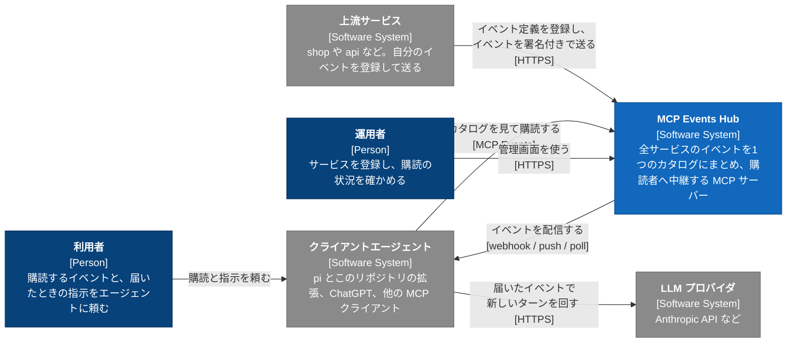
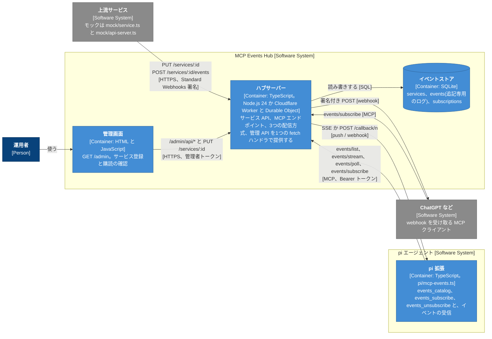
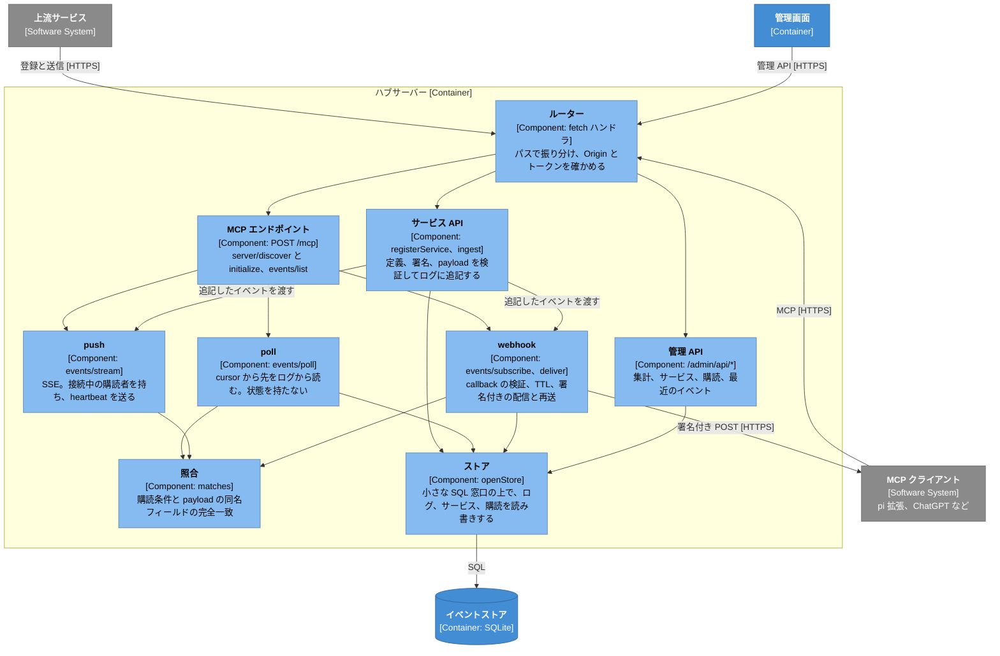
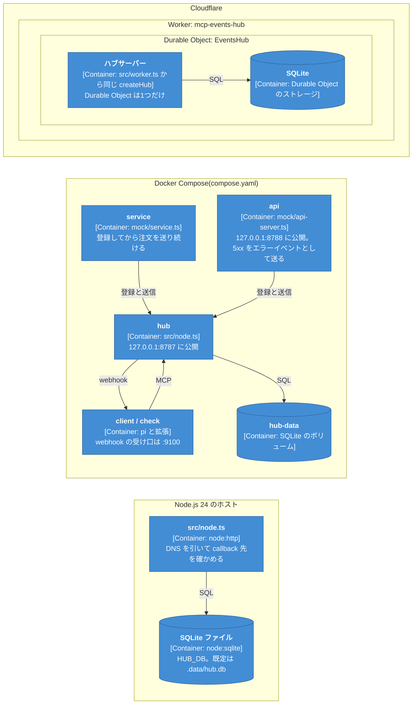
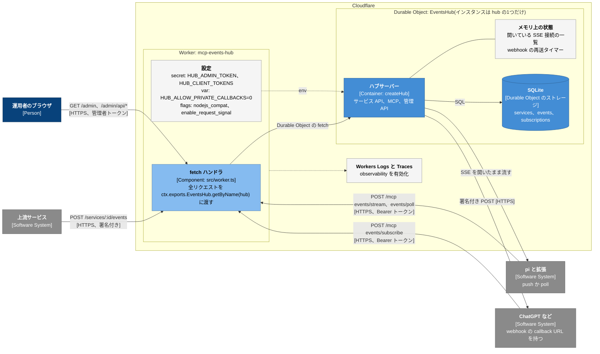

# mcp-events-hub-server

[MCP Events](https://github.com/modelcontextprotocol/experimental-ext-triggers-events/blob/main/docs/design-sketch-proposal.md) を中継するハブです。上流サービスは自前の MCP Events サーバーを作らず、イベント定義の登録と署名付き webhook の送信だけを実装します。クライアントエージェントはハブ 1 か所に接続し、全サービスのイベントを 1 つのカタログから購読します。

ハブの中身は追記専用のイベントログです。poll、push、webhook の 3 つの配信方式は同じログを読み、cursor はログの連番です。webhook しか受けられない ChatGPT も、公開 URL を持たない pi のようなローカルエージェントも、同じイベントを受け取れます。

ハブ本体は Web 標準の `Request` と `Response` を受け渡す 1 つの fetch ハンドラ(`src/hub.ts`)です。同じコードを Node.js(`src/node.ts`)と Cloudflare Workers の Durable Object(`src/worker.ts`)で動かします。Node.js で動かすときの依存パッケージはなく、Node.js 24 以上で `.ts` をそのまま実行します。Cloudflare 向けの開発とビルドには devDependencies の `cf`、`@cloudflare/vite-plugin`、`vite` を使います。

このリポジトリには、ハブのほかに 2 つの役割の実装が入っています。`mock/service.ts` は上流サービスの見本で、shop サービスを登録して注文イベントを送ります。`mock/api-server.ts` も上流サービスの見本で、5xx を返すたびにエラーイベントを送る小さな HTTP API です。`pi/mcp-events.ts` は [pi](https://www.npmjs.com/package/@earendil-works/pi-coding-agent) の拡張で、ハブのイベントを購読し、届くたびに pi の新しいターンを始めます。

設計と使い方を図にしたページは [`docs/mcp-events-hub.html`](docs/mcp-events-hub.html) です。ブラウザで直接開けます。

## アーキテクチャ(C4 モデル)

C4 モデルのレベル1から3(コンテキスト、コンテナ、コンポーネント)と、デプロイの図で、MCP Events Hub の構造を示します。図は Mermaid の flowchart で描き、C4 の表記にあわせて、要素の種類を `[Person]`、`[Software System]`、`[Container: 技術]`、`[Component: 技術]` のように書いています。青が MCP Events Hub、灰色が外部のシステムです。

### レベル1 システムコンテキスト

誰が、どのシステムが、MCP Events Hub とどうやり取りするかを示します。



### レベル2 コンテナ

MCP Events Hub と、このリポジトリが提供するクライアント側の部品を、動く単位に分けて示します。



### レベル3 コンポーネント(ハブサーバー)

ハブサーバー(`src/hub.ts` の `createHub`)の中の部品を示します。Node と Cloudflare のどちらで動かしても、この中身は同じです。



### デプロイ

同じハブサーバーを、Node、Docker、Cloudflare のどれにも置けます。枠は配置先(Deployment Node)です。



### デプロイ(Cloudflare)

Cloudflare に置いたときの構成です。`cloudflare.config.ts` と `src/worker.ts` をそのまま `cf deploy` した形で、リクエストの流れ、秘密情報と設定の置き場所、外へ出る webhook の線を示します。



Worker は受け取ったリクエストを渡すだけで、ハブの処理はすべて1つの Durable Object の中で動きます。cursor をログ全体の通し番号にしているので、ログを1か所にまとめています。デプロイは `cloudflare.config.ts` から `cf build` で `.cloudflare/output/v0/` を作り、`cf deploy --secrets-file <ファイル>` で秘密情報と一緒に送ります。

## 必要なもの

| もの | 使う場面 |
|---|---|
| Docker と Docker Compose | Docker で動かすとき。手元では Docker Desktop 29 と Compose 5.5 で確かめた |
| Node.js 24 以上 | Node.js で動かすとき、テスト、`scripts/smoke.ts` |
| pi(`@earendil-works/pi-coding-agent`) | 手元の pi に拡張を入れるとき。Docker の client には入っている |
| Anthropic の API キー | pi に LLM を動かさせるとき(Docker の client と check、`npm run demo`) |
| `cf` CLI | Cloudflare で動かすときだけ。`npm install` で入る |

## Docker で動かす

`compose.yaml` は hub、service、client の 3 つの役割を別々のコンテナで動かします。check は client と同じイメージで、自動の確認だけをします。

| サービス | 中身 | 起動のしかた |
|---|---|---|
| `hub` | ハブ(`src/node.ts`)。コンテナ内の 0.0.0.0:8787 で待ち受け、ホストの 127.0.0.1:8787 に公開する。SQLite は名前付きボリューム `hub-data` に置く | `docker compose up` |
| `service` | モックの shop サービス(`mock/service.ts`)。起動時に shop を登録し、3 秒ごとに alice か bob の注文を送る | `docker compose up` |
| `api` | モックの HTTP API(`mock/api-server.ts`)。起動時に api を登録し、ホストの 127.0.0.1:8788 に公開する。5xx を返すたびに `api.error.occurred` を送る | `docker compose up` |
| `client` | pi と拡張。拡張はこのリポジトリを `pi install /app` で pi のパッケージとして入れてある | `docker compose run` |
| `check` | `client` と同じイメージで `scripts/pi-demo.ts` を実行し、3 つの配信方式を実際の LLM で確かめる | `docker compose run` |

`client` と `check` は compose の profile に入っているので、`docker compose up` では起動しません。

### 1. API キーを置く

リポジトリ直下に `.env`(git 管理外)を作り、Anthropic の API キーを書きます。

```sh
echo 'ANTHROPIC_API_KEY=sk-ant-...' > .env
```

compose はこのファイルを `compose.yaml` の `${...}` の置き換えにだけ使います。キーを渡すのは `client` と `check` のコンテナだけで、`hub`、`service`、`api` のコンテナには渡りません。キーはイメージにも入りません。

### 2. イメージを作る

```sh
docker compose --profile client --profile check build
```

hub、service、api のイメージは `node:24-slim` にソースをコピーしただけで、npm install をしません。client のイメージは pi 1.3.0 を `npm install -g` で入れ、続けて `pi install /app` で拡張を入れます。pi の設定ディレクトリはイメージ内の `/home/node/.pi/agent`(`PI_CODING_AGENT_DIR`)で、ホストの `~/.pi` は読みません。どのコンテナも `node` ユーザーで動きます。

社内プロキシが TLS を傍受する環境では、npm の取得が `SELF_SIGNED_CERT_IN_CHAIN` で失敗します。そのときはプロキシの CA 証明書を PEM で用意し、環境変数 `EXTRA_CA_CERTS_PEM` に中身を入れてビルドします。macOS でシステムのキーチェーンに CA が入っている場合は次のとおりです。

```sh
security find-certificate -a -p /Library/Keychains/System.keychain > ~/extra-ca.pem
EXTRA_CA_CERTS_PEM="$(cat ~/extra-ca.pem)" docker compose --profile client --profile check build
```

compose はこの値をビルドシークレット `extra-ca` として渡し、`Dockerfile` は npm install の 1 ステップだけで `NODE_EXTRA_CA_CERTS` に使います。証明書はイメージのレイヤーに残りません。手元の環境では、コンテナから api.anthropic.com への接続は傍受されておらず、実行時に CA は要りませんでした。

### 3. ハブとサービスを起動する

```sh
docker compose up -d
docker compose ps                 # hub が healthy になってから service が起動する
docker compose logs -f service    # 送った注文が 1 行ずつ出る
```

service のログは次のように出ます。

```
registered shop.order.created, shop.order.shipped; secret saved to .data/shop.secret
emit order.created {"order_id":"ord_d73009e5","customer":"alice","amount":91630,"currency":"JPY"} -> HTTP 202 {"seq":32}
```

ingest の secret は service コンテナの中の `/app/.data/shop.secret` に保存します。ハブは再登録しても同じ secret を返すので、コンテナを作り直しても続けて送れます。

ブラウザで http://127.0.0.1:8787/admin を開き、トークンに `dev-admin` を入れると管理画面が見えます。画面の内容は「管理画面」の節にあります。API で確かめるときは次のとおりです。

```sh
curl -H 'Authorization: Bearer dev-admin' http://127.0.0.1:8787/admin/api/overview
# {"services":1,"eventTypes":2,"webhooks":{"live":1,"failing":0,"expired":0},"pushStreams":1,"events":5}
```

`docker compose up -d` では、ハブから届くイベントを表示するだけの購読者も 4 つ起動します。pi も LLM も使わず、pi の拡張と同じ受信の処理(`scripts/watch.ts`)で購読します。

| コンテナ | 購読するイベント | 配信方式 | 購読条件 |
|---|---|---|---|
| `watch-push` | `shop.order.created` | push | `{"customer":"alice"}` |
| `watch-poll` | `shop.order.created` | poll | `{"customer":"bob"}` |
| `watch-webhook` | `shop.order.created` | webhook(ハブが `http://watch-webhook:9100` へ POST) | 条件なし |
| `watch-errors` | `api.error.occurred` | push | `{"severity":"critical"}` |

```sh
docker compose logs -f watch-push watch-poll watch-webhook watch-errors
```

届いたイベントが 1 件ずつ出ます。購読条件に合わないイベントは出ません。

```
watch-push-1     | #3 [push] 2026-10-19T06:23:42.821Z shop.order.created msg_94eb… {"order_id":"ord_c70382e6","customer":"alice","amount":94340,"currency":"JPY"}
watch-poll-1     | #1 [poll] 2026-10-19T06:23:51.920Z shop.order.created msg_bcb0… {"order_id":"ord_b2975c42","customer":"bob","amount":72653,"currency":"JPY"}
watch-webhook-1  | #5 [webhook] 2026-10-19T06:23:48.881Z shop.order.created msg_b552… {"order_id":"ord_edcaab2b","customer":"alice","amount":45226,"currency":"JPY"}
```

管理画面の「購読」タブには、`watch-push` の push 接続と、`watch-webhook` の webhook 購読が出ます。poll はハブに状態を残さないので出ません。

ホストから同じように確かめるときは、`node scripts/watch.ts <イベント名> '<購読条件の JSON>'` を使います。ハブの場所とトークンは `MCP_EVENTS_HUB_URL` と `MCP_EVENTS_HUB_TOKEN` で、配信方式は `MCP_EVENTS_DELIVERY` で渡します。

```sh
MCP_EVENTS_HUB_URL=http://127.0.0.1:8787/mcp MCP_EVENTS_HUB_TOKEN=dev-client \
  node scripts/watch.ts shop.order.created '{"customer":"alice"}'
```

### 4. pi をつなぐ

```sh
docker compose run --rm --use-aliases client
```

拡張を読み込んだ pi の TUI が開きます。「shop.order.created を customer=alice で購読して、届いたら金額を報告して」と頼むと、service が alice の注文を送るたびに新しいターンが始まります。モデルを選ぶときは `docker compose run --rm --use-aliases client pi --model anthropic/claude-haiku-5-5` のように引数を付けます。何も付けないと pi が自動で選び、手元では `anthropic/claude-opus-4-8` になりました。

`--use-aliases` は、`docker compose run` で作るコンテナにサービス名 `client` を DNS 名として付けるためのものです。webhook で受けるとき(`MCP_EVENTS_DELIVERY=webhook`)、拡張は受け口を 0.0.0.0:9100 で開き、ハブには `http://client:9100/callback/<n>` を渡します。ハブのコンテナはこの名前で client のコンテナに届けます。push と poll ではこのフラグがなくても動きます。

配信方式を変えるときは `docker compose run --rm --use-aliases -e MCP_EVENTS_DELIVERY=webhook client` のように渡します。

### 5. 自動で確かめる

```sh
docker compose run --rm --use-aliases check
```

`check` は client のイメージで `scripts/pi-demo.ts` を実行します。`PI_DEMO_INSTALLED=1` で、`--extension` を使わずにイメージに入れたパッケージから拡張を読み込みます。対象は hub コンテナ(`PI_DEMO_HUB_URL=http://hub:8787`)で、push、poll、webhook の順に pi を起動し、alice の注文だけに `ORDER o-alice-1 4200 JPY` と返すことを確かめます。webhook はハブのコンテナから check のコンテナの `http://check:9100` に届きます。3 つとも通れば終了コード 0、1 つでも落ちれば 1 です。

```
PASS push (4s): alice's order triggered a turn with the expected reply; bob's order never reached pi
PASS poll (5s): alice's order triggered a turn with the expected reply; bob's order never reached pi
PASS webhook (4s): alice's order triggered a turn with the expected reply; bob's order never reached pi
summary: 3/3 passed with anthropic/claude-haiku-5-5
```

ホストからハブのコンテナを確かめるときは `scripts/smoke.ts` を使います。webhook の受け口はホストの 127.0.0.1 で開くので、Docker Desktop のコンテナからホストに届く名前 `host.docker.internal` を `SMOKE_CALLBACK_HOST` で渡します。

```sh
SMOKE_CALLBACK_HOST=host.docker.internal node scripts/smoke.ts http://127.0.0.1:8787
```

### 例: サーバーのエラーをエージェントが受け取る

サーバーがエラーを返すとエラーイベントがハブに届き、エラーを購読しているエージェントがそれを受け取って対応します。compose の `api` と `watch-errors` がこの関係を LLM なしで再現し、pi をつなげば pi が対応します。

`api`(`mock/api-server.ts`)は小さな HTTP API で、`GET /health` と `GET /orders/:id` に答えます。5xx を返すたびに、応答を返したあとで `api.error.occurred` をハブに送ります。`/orders/:id` に `?fail=critical` を付けると 500(`database connection timed out`)、`?fail=warning` を付けると 503(`payment provider responded slowly`)で失敗します。compose の `api` は 2 秒ごとに自分の `/orders/:id` を呼び、その 2 割が critical か warning で失敗するので、何もしなくてもエラーが起きます。この 2 割の失敗は手で送ったリクエストにもかかるので、`?fail` を付けない curl が 500 や 503 になることもあります。

`api.error.occurred` の payload は次のフィールドを持ちます。購読条件には `severity` と `route` を使えます。

| フィールド | 内容 |
|---|---|
| `error_id` | エラーごとの ID。イベントの `eventId` にも使う |
| `request_id` | リクエストの ID。応答の `x-request-id` ヘッダーと本文にも入る |
| `method` / `route` / `status` | HTTP メソッド、ルートの型(`/orders/42` ではなく `/orders/:id`)、返したステータス |
| `severity` | `critical`(500)か `warning`(503) |
| `message` | 失敗の説明 |

`watch-errors` は `api.error.occurred` を `{"severity":"critical"}` で push 購読し、届いたイベントを 1 行ずつ出します。

```sh
docker compose logs -f watch-errors
```

別の端末で critical のエラーを起こします。

```sh
curl -i 'http://127.0.0.1:8788/orders/42?fail=critical'
# HTTP/1.1 500 Internal Server Error
# x-request-id: req_ba9f42ff
# {"request_id":"req_ba9f42ff","error":"database connection timed out"}
```

`watch-errors` に同じ `request_id` のイベントが出ます。

```
watch-errors-1  | #1 [push] 2026-10-19T07:02:33.936Z api.error.occurred err_101816b1 {"error_id":"err_101816b1","request_id":"req_ba9f42ff","method":"GET","route":"/orders/:id","severity":"critical","status":500,"message":"database connection timed out"}
```

`?fail=warning` の 503 も `api.error.occurred` としてハブに届きますが、購読条件に合わないので `watch-errors` には出ません。API のすべての応答と送ったイベントは `docker compose logs -f api` で見えます。

pi に対応させるときは、client を起動します。

```sh
docker compose run --rm --use-aliases client
```

pi に「api.error.occurred を severity が critical のものだけ購読して。届いたら、何が失敗したか、考えられる原因、次に確認すべきことを短いトリアージで答えて。」と頼みます。pi は `events_subscribe` を `{"severity":"critical"}` で呼びます。上の curl で critical のエラーを起こすと、pi の新しいターンが始まり、次のように答えます(`anthropic/claude-haiku-5-5` で試したときの応答を縮めたもの)。

```
1) 失敗の内容: GET /orders/:id が HTTP 500 で失敗。message: database connection timed out(request_id: req_8d1e93e2)
2) 考えられる原因: DB の過負荷や接続プール枯渇による接続待ちのタイムアウト、DB 自体の障害やネットワーク遅延
3) 次に確認すべきこと: エラー発生時刻前後の DB のメトリクス(接続数、レイテンシ、スロークエリ)、同じ route でエラーが続いているか、直近のデプロイや接続設定の変更
```

compose の `api` は自分でも 20 秒に 1 回ほど critical のエラーを起こすので、curl を使わなくても同じように pi のターンが始まります。

### トークンを変える

compose のトークンは既定で `dev-admin`(管理用)と `dev-client`(pi 用)です。変えるときは `.env` に書くか、シェルの環境変数で渡します。

```sh
HUB_ADMIN_TOKEN=my-admin
HUB_CLIENT_TOKEN=my-client
```

`HUB_ADMIN_TOKEN` は hub、service、api、check に、`HUB_CLIENT_TOKEN` は hub(`HUB_CLIENT_TOKENS=pi:<値>`)、client、check に同じ値で渡ります。変えたら `docker compose up -d` で hub、service、api を作り直します。トークンは HTTP ヘッダーに入るので、ASCII の記号と英数字だけで書きます。

compose の hub は `HUB_ALLOW_PRIVATE_CALLBACKS=1` で起動します。コンテナのネットワークのアドレスはプライベートアドレスなので、これがないとハブは client コンテナの webhook 受け口に届けません。この設定とトークンの既定値は、手元で compose を動かすためだけのものです。

### 止める、データを消す

```sh
docker compose down       # コンテナを止めて消す。イベントログはボリューム hub-data に残る
docker compose down -v    # ボリュームも消して、次の起動を空のハブから始める
```

## Node.js で動かす

```sh
HUB_ADMIN_TOKEN=dev-admin HUB_CLIENT_TOKENS=pi:dev-client HUB_ALLOW_PRIVATE_CALLBACKS=1 npm start
npm run mock -- register                     # shop サービスを登録し .data/shop.secret に保存
npm run mock -- emit order.created '{"order_id":"o-1","customer":"alice","amount":1200,"currency":"JPY"}'
npm run mock -- loop 5                        # 5 秒ごとにランダムな注文を送る
node mock/api-server.ts                       # api サービスを登録し 127.0.0.1:8788 で待ち受ける
```

ハブは http://127.0.0.1:8787 で待ち受け、イベントログを `.data/hub.db` に保存します。

## pi に拡張を入れる

拡張を pi のパッケージとしてインストールします。このリポジトリの `package.json` が pi パッケージの定義を兼ねていて、`pi/mcp-events.ts` を拡張として読み込みます。インストールしても、ハブ側の開発用の依存(`cf`、`vite` など)は入りません。

```sh
pi install git:github.com/umaidashi/mcp-events-hub-server   # GitHub から
pi install /path/to/mcp-events-hub-server                   # 手元のクローンから(コピーせずにそのまま読む)
```

拡張はハブの場所とトークンを環境変数から読みます。シェルの設定ファイルに書いておくと、pi を起動するたびに指定せずに済みます。トークンはハブの `HUB_CLIENT_TOKENS` のうち 1 つの `token` の部分で、ASCII の記号と英数字だけで書きます。日本語や空白が入っていると、拡張のツールは `MCP_EVENTS_HUB_TOKEN` を直すよう求めるエラーを返します。

```sh
export MCP_EVENTS_HUB_URL=http://127.0.0.1:8787/mcp
export MCP_EVENTS_HUB_TOKEN=dev-client
pi
```

インストールせずに 1 回だけ試すときは `pi --extension pi/mcp-events.ts` で読み込めます。外すときは `pi remove git:github.com/umaidashi/mcp-events-hub-server` です。

pi のモデルには `events_catalog`、`events_subscribe`、`events_unsubscribe` の 3 つのツールが見えます。「shop.order.created を customer=alice で購読して、届いたら金額を報告して」のように頼むと、イベントが届くたびに新しいターンが始まります。

拡張は既定で push を使い、ハブが push を出していなければ poll を使います。`MCP_EVENTS_DELIVERY` で配信方式を固定できます。環境変数の一覧は「設定」の節にあります。

webhook を選ぶと、拡張は最初の購読で HTTP サーバーを開き、購読ごとに `/callback/<n>` と `whsec_` secret を作って `events/subscribe` に渡します。ChatGPT と同じ経路をローカルで通すためのもので、ハブは `HUB_ALLOW_PRIVATE_CALLBACKS=1` で起動します。受け口は既定で 127.0.0.1 に開きます。ハブが別のホストやコンテナにあるときは、`MCP_EVENTS_CALLBACK_HOST` で待ち受けるアドレスを、`MCP_EVENTS_CALLBACK_URL` でハブから届く URL を指定します。受け口は Standard Webhooks の署名を 5 分の許容幅で検証し、challenge に応答し、イベントを eventId で重複排除します。購読を解除すると `events/unsubscribe` を呼び、最後の購読が終わったらサーバーを閉じます。

## Cloudflare で動かす

Cloudflare 版は Worker 1 つと SQLite ストレージの Durable Object `EventsHub` 1 つで動きます。Worker は受けたリクエストをすべて `EventsHub` に渡し、ハブは Durable Object の SQLite にイベントログ、サービス、購読を保存します。構成は `cloudflare.config.ts` に、開発サーバーの設定は `vite.config.ts` に書いてあります。

```sh
npm install
cp .dev.vars.example .dev.vars    # HUB_ADMIN_TOKEN と HUB_CLIENT_TOKENS(git 管理外)
npm run cf:dev                     # cf dev。http://127.0.0.1:5173 で待ち受ける
HUB_URL=http://127.0.0.1:5173 npm run mock -- register
```

`cf dev` はローカルの workerd でハブを動かし、Durable Object のデータを `.cloudflare/state/` に保存します。Worker が読む秘密情報は `.dev.vars` の `HUB_ADMIN_TOKEN` と `HUB_CLIENT_TOKENS` だけです。`.env` にある `ANTHROPIC_API_KEY` などは Worker に渡りません。`cf dev` は development モードで動き、ローカルの webhook 受け口に届くよう `HUB_ALLOW_PRIVATE_CALLBACKS` を `1` にします。ビルドとデプロイでは `0` です。

```sh
npm run cf:build                                          # .cloudflare/output/v0/ に Build Output を作る。認証は不要
npx cf deploy --dry-run                                   # アップロードせずにビルドと検証だけ行う
npm run cf:deploy -- --secrets-file <秘密情報のファイル>     # .dev.vars と同じ形式のファイルで秘密情報も一緒に送る
npm run cf:types                                          # .cloudflare/types/index.d.ts に Env とランタイムの型を書き出す
```

デプロイには `cf auth login` か `CLOUDFLARE_API_TOKEN` が必要です。`.cloudflare/` はビルドと型の生成物なので git 管理外です。

## 設定

ハブ(`src/node.ts`、`src/worker.ts`)の環境変数です。

| 環境変数 | 既定値 | 内容 |
|---|---|---|
| `PORT` / `HOST` | `8787` / `127.0.0.1` | Node.js の待ち受けアドレス。compose では `HOST=0.0.0.0` |
| `HUB_DB` | `.data/hub.db` | Node.js の SQLite ファイル。`:memory:` も可。compose では `/data/hub.db` |
| `HUB_ADMIN_TOKEN` | なし | サービス登録と管理画面の Bearer トークン。未設定なら登録も管理画面の API も使えない |
| `HUB_CLIENT_TOKENS` | なし | `principal:token,...`。未設定なら全員 `anonymous` になり、webhook 購読は拒否される |
| `HUB_ALLOW_PRIVATE_CALLBACKS` | なし | `1` で http とプライベートアドレスへの callback を許可する(開発用) |

Cloudflare では `HUB_ADMIN_TOKEN` と `HUB_CLIENT_TOKENS` を秘密情報として、`HUB_ALLOW_PRIVATE_CALLBACKS` を `cloudflare.config.ts` の値として渡します。`PORT`、`HOST`、`HUB_DB` は使いません。

pi の拡張(`pi/mcp-events.ts`)の環境変数です。どれも pi の起動時に読みます。

| 環境変数 | 既定値 | 内容 |
|---|---|---|
| `MCP_EVENTS_HUB_URL` | `http://127.0.0.1:8787/mcp` | ハブの MCP エンドポイント |
| `MCP_EVENTS_HUB_TOKEN` | なし | ハブの `HUB_CLIENT_TOKENS` のうち 1 つのトークン。ASCII だけで書く |
| `MCP_EVENTS_DELIVERY` | push、なければ poll | `push`、`poll`、`webhook` のどれか。ハブが出していない方式を選ぶと購読ツールがエラーを返す |
| `MCP_EVENTS_CALLBACK_HOST` | `127.0.0.1` | webhook の受け口を開くアドレス。compose では `0.0.0.0` |
| `MCP_EVENTS_CALLBACK_PORT` | `0`(空きポート) | webhook の受け口を開くポート。compose では `9100` |
| `MCP_EVENTS_CALLBACK_URL` | `http://<CALLBACK_HOST>:<ポート>` | ハブに渡す受け口の URL。この後ろに `/callback/<n>` を付ける。compose では `http://client:9100` |
| `MCP_EVENTS_TTL_MS` | `3600000` | webhook 購読に求める TTL。残り時間の 8 割が過ぎたら最新の cursor で `events/subscribe` を呼び直す |

compose(`compose.yaml`)が読む環境変数です。`.env` かシェルの環境変数で渡します。

| 環境変数 | 既定値 | 内容 |
|---|---|---|
| `ANTHROPIC_API_KEY` | なし | client と check の pi が使う API キー |
| `HUB_ADMIN_TOKEN` | `dev-admin` | hub、service、api、check の管理用トークン |
| `HUB_CLIENT_TOKEN` | `dev-client` | client と check のトークン。hub には `HUB_CLIENT_TOKENS=pi:<値>` として渡る |
| `EXTRA_CA_CERTS_PEM` | なし | client のビルドで npm が信頼する CA 証明書の PEM。TLS を傍受するプロキシがある環境だけで使う |

モックの API(`mock/api-server.ts`)の環境変数です。

| 環境変数 | 既定値 | 内容 |
|---|---|---|
| `HUB_URL` / `HUB_ADMIN_TOKEN` | `http://127.0.0.1:8787` / `dev-admin` | 登録とイベント送信の宛先のハブと、その管理用トークン |
| `PORT` / `HOST` | `8788` / `127.0.0.1` | API の待ち受けアドレス。compose では `HOST=0.0.0.0` |
| `API_FAILURE_RATE` | `0` | `/orders/:id` が `?fail` なしでも失敗する割合(0 から 1)。失敗は critical と warning が半々。compose では `0.2` |
| `API_TRAFFIC_INTERVAL_SEC` | `0`(止める) | この秒数ごとに自分の `/orders/:id` を呼ぶ。compose では `2` |

`scripts/pi-demo.ts` と `scripts/smoke.ts` の環境変数です。

| 環境変数 | 既定値 | 内容 |
|---|---|---|
| `HUB_ADMIN_TOKEN` / `HUB_CLIENT_TOKEN` | `dev-admin` / `dev-client` | 対象のハブのトークン |
| `PI_DEMO_MODEL` | `anthropic/claude-haiku-5-5` | デモの pi のモデル。Anthropic 以外を指定すると `~/.pi/agent` のログイン情報を使う |
| `PI_DEMO_DELIVERY` | `all` | `push`、`poll`、`webhook`、`all` のどれか |
| `PI_DEMO_HUB_URL` | なし | 指定するとハブを起動せず、その URL のハブを使う |
| `PI_DEMO_INSTALLED` | なし | `1` で `--extension` を使わず、設定ディレクトリにインストールした拡張を読み込む |
| `PI_CODING_AGENT_DIR` | `.data/pi-agent` | Anthropic のモデルで使う pi の設定ディレクトリ。client のイメージでは `/home/node/.pi/agent` |
| `SMOKE_CALLBACK_HOST` | `127.0.0.1` | smoke の webhook 受け口にハブから届くホスト名。ハブが Docker にあるときは `host.docker.internal` |

## 管理画面

ハブを起動したら、ブラウザで `/admin`(Node.js と Docker なら http://127.0.0.1:8787/admin、`cf dev` なら http://127.0.0.1:5173/admin)を開きます。最初に `HUB_ADMIN_TOKEN` の値を入れると、そのタブを閉じるまでブラウザの sessionStorage に保存します。

画面の上段には、サービス数、イベント種別の数、webhook 購読の数(有効、失敗中、期限切れの内訳)、開いている push ストリームの数、保存したイベントの数が並びます。その下の 3 つのタブで詳細を確認します。

- サービス。登録済みのサービスと、イベントごとのフィルタと payload のフィールドを一覧します。フォームから `PUT /services/:id` と同じ検証でサービスを登録できます。登録に成功すると ingest secret を 1 回だけ表示します。
- 購読。webhook 購読の状態、principal、フィルタ、callback URL、期限、最終配信、最終エラーと、いま開いている push ストリームを一覧します。poll はハブに状態を残さないので一覧はありません。
- 最近のイベント。イベントログを新しい順に 50 件表示します。

画面が読む API は `GET /admin/api/overview`、`/admin/api/services`、`/admin/api/subscriptions`、`/admin/api/events?limit=50`(最大 200)で、どれも `Authorization: Bearer $HUB_ADMIN_TOKEN` が必要です。ingest secret と webhook の secret はどの API も返しません。

## サービス側の API

サービスの実装はこの 2 つだけです。

`PUT /services/:id` は `Authorization: Bearer $HUB_ADMIN_TOKEN` 付きでイベント定義を登録します。応答の `secret` で ingest を署名します。再登録しても secret は変わりません。

```json
{ "name": "Shop", "events": [{
  "name": "order.created", "description": "A customer placed an order.",
  "inputSchema":   { "type": "object", "properties": { "customer": { "type": "string" } } },
  "payloadSchema": { "type": "object", "properties": { "order_id": {"type":"string"}, "customer": {"type":"string"} },
                     "required": ["order_id", "customer"] } }] }
```

`inputSchema` の各プロパティは、同名の payload フィールドとの完全一致フィルタです。payload に存在しないフィルタは登録時に拒否します。クライアントには `<service id>.<event name>` という名前で公開します。`mock/api-server.ts` の `api` は、`severity`(`enum` で `warning` か `critical`)と `route` をフィルタにした例です。

`POST /services/:id/events` は [Standard Webhooks](https://www.standardwebhooks.com) 形式(`webhook-id`、`webhook-timestamp`、`webhook-signature`)で署名した `{ "name", "data", "eventId"?, "timestamp"? }` を受け取ります。`eventId` を省くと `webhook-id` を使います。同じ `eventId` の再送は 1 回だけ記録します。

## クライアント側の MCP

`POST /mcp` は 2026-07-28(`server/discover`、リクエストごとの `_meta`)と 2025-11-25 以前(`initialize`)の両方を受け付けます。

| メソッド | 用途 |
|---|---|
| `events/list` | 全サービスのイベントカタログ。全イベントが `webhook`、`push`、`poll` に対応する |
| `events/subscribe` / `events/unsubscribe` | webhook 購読。callback の challenge 検証、TTL、署名付き配信、指数バックオフの再送(410 と 413 は再送しない)を行う |
| `events/stream` | push。SSE で `active`、`event`、`heartbeat` を送る |
| `events/poll` | poll。`cursor`、`hasMore`、`nextPollMs` を返す |

## 検証

- `npm test` は 40 件のテストで、LLM を使いません。`test/hub.test.ts` は実際の HTTP 越しに両方の世代のハンドシェイク、ingest、3 つの配信方式、署名検証、再送、challenge 失敗、管理画面の API と CSP を確認します。`test/api-server.test.ts` はハブと `mock/api-server.ts` を起動し、500 と 503 の応答がそれぞれ 1 件ずつ `api.error.occurred` としてハブに届き、200 の応答では何も届かないことを確認します。`test/pi-extension.test.ts` は pi の拡張のツールを直接呼び、push、poll、webhook のそれぞれで、条件に合うイベントだけが届き、購読解除後は届かないことと、webhook 受信口が偽造や古い署名を拒否することと、`MCP_EVENTS_CALLBACK_URL` の URL をハブに渡してそこに届くことを確認します。
- `node scripts/smoke.ts <ハブの URL>` は動いているハブに HTTP で接続し、`server/discover`、shop の登録、署名が違う ingest の拒否、poll(alice には届き bob には届かない)、push の `active` と配信、webhook の challenge と署名付き配信と購読解除を確認します。結果を 1 行ずつ出し、すべて通れば終了コード 0 です。webhook の確認には、`SMOKE_CALLBACK_HOST`(既定 `127.0.0.1`)への http callback を許すハブが必要です。`npm start` を上の例どおりに起動した場合と、`npm run cf:dev` の場合はそのまま通ります。Docker のハブは「Docker で動かす」の手順どおりに `host.docker.internal` を渡します。
- `node scripts/pi-demo.ts` は実際の LLM で pi を動かします。push、poll、webhook の順に、毎回新しいハブと pi を起動します。pi がカタログを見て alice の注文だけを購読し、bob の注文には反応せず、指定した方式で届いた alice の注文で `ORDER o-alice-1 4200 JPY` と返すことを確認します。方式ごとに PASS か FAIL を 1 行出し、1 つでも落ちたら終了コード 1 で終わります。Docker では `docker compose run --rm --use-aliases check` が同じことをします。
  - 既定のモデルは `anthropic/claude-haiku-5-5` で、`ANTHROPIC_API_KEY` が必要です。リポジトリ直下の `.env`(git 管理外)に `ANTHROPIC_API_KEY=sk-ant-...` と書き、`npm run demo` で実行します。スクリプトは空の `.data/pi-agent` を `PI_CODING_AGENT_DIR` として pi に渡すので、`~/.pi/agent/auth.json` の claude.ai ログインは使わず、API キーだけで動きます。`PI_CODING_AGENT_DIR` がすでに設定されていれば、そのディレクトリを使います。
  - `PI_DEMO_DELIVERY=push|poll|webhook|all` で方式を絞れます。`PI_DEMO_MODEL=openai-codex/gpt-5.6-luna` のように Anthropic 以外を指定すると、`~/.pi/agent` のログイン情報を使います。
  - `PI_DEMO_HUB_URL=http://127.0.0.1:5173 npm run demo` のように URL を渡すと、ハブを起動せずにそのハブを使います。トークンは `HUB_ADMIN_TOKEN`(既定 `dev-admin`)と `HUB_CLIENT_TOKEN`(既定 `dev-client`)で渡します。webhook の確認には、拡張の受け口に http で届くハブが必要です。
  - `PI_DEMO_INSTALLED=1` を付けると、`--extension` を使わず、デモ用の設定ディレクトリ `.data/pi-agent` にインストールした拡張を読み込みます。先に `PI_CODING_AGENT_DIR=$PWD/.data/pi-agent pi install $PWD` でインストールしておきます。
